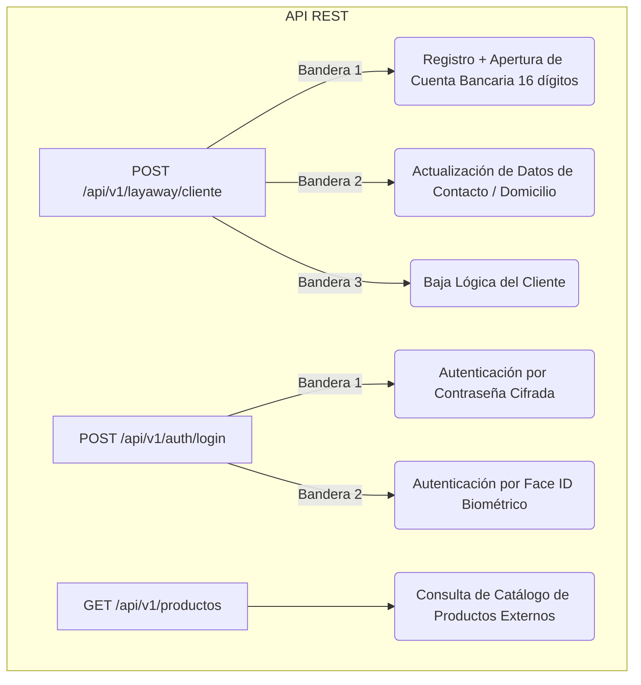

# Documentación Integral del Proyecto: Onboarding de Clientes, Autenticación y Catálogo de Productos

**Proyecto**: API de Servicios Financieros y Onboarding de Clientes  
**Versión**: 2.0.0  
**Tecnologías**: Java 21, Spring Boot 3.3+, PostgreSQL, Flyway, Docker, Swagger / OpenAPI 3, JUnit 5 & Mockito  
**Autor / Equipo**: Equipo de Desarrollo  

---

## 1. Resumen General del Sistema

El sistema implementa una solución integral compuesta por tres pilares funcionales:
1. **Onboarding y Gestión Integral de Clientes (`POST /api/v1/layaway/cliente`)**: Manejo de ciclo de vida del cliente mediante banderas unificadas, validaciones estrictas de datos, catálogos normalizados, asignación automática de cuenta bancaria de 16 dígitos y saldos en escala decimal (`0.00`).
2. **Autenticación y Biometría (`POST /api/v1/auth/login`)**: Inicio de sesión multifactorial con soporte para contraseña cifrada (Bandera 1) y Face ID biométrico numérico (Bandera 2), con control de sesiones dinámicas.
3. **Catálogo de Productos (`GET /api/v1/productos`)**: Consumo e integración con el servicio externo PuntoRed / GestoPago con alta resiliencia.

---

## 2. Arquitectura de Endpoints y Banderas



---

## 3. Especificación de Endpoints

### 3.1. Gestión de Clientes (`POST /api/v1/layaway/cliente`)

* **Ruta**: `/api/v1/layaway/cliente`
* **Método**: `POST`
* **Consumes / Produces**: `application/json`

#### Banderas de Operación:
| Bandera | Operación | Comportamiento |
| :---: | :--- | :--- |
| **`1`** | **Insertar (Registro)** | Valida datos personales, crea registro en tabla `usuarios`, genera cuenta bancaria de 16 dígitos (`4152...`), saldo en `$0.00` y credenciales de acceso. |
| **`2`** | **Actualizar** | Requiere `clienteId`. Permite actualizar nombre, domicilio y teléfonos, **protegiendo la inmutabilidad de CURP y RFC**. |
| **`3`** | **Eliminar (Baja Lógica)** | Requiere `clienteId`. Marca al usuario como inactivo (`activo = false`) sin eliminar registros históricos. |

---

### 3.2. Autenticación de Usuarios (`POST /api/v1/auth/login`)

* **Ruta**: `/api/v1/auth/login`
* **Método**: `POST`

#### Banderas de Autenticación:
| Bandera | Mecanismo | Parámetros Requeridos |
| :---: | :--- | :--- |
| **`1`** | **Contraseña** | `"usuario"` (o correo/username) + `"password"` |
| **`2`** | **Face ID Biométrico** | `"usuario"` + `"faceId"` (o `"faceIdBiometrico"`, numérico `Long`) |

---

## 4. Reglas de Validación Estrictas y Catálogos

### 4.1. Catálogos Normalizados

#### Catálogo de Sexo (`SexoEnum`)
* **Valores Oficiales**: `M` (Masculino), `F` (Femenino), `OTRO` (Otro).
* **Entradas Aceptadas y Normalizadas**: `"M"`, `"MASCULINO"`, `"HOMBRE"` $\rightarrow$ `M`; `"F"`, `"FEMENINO"`, `"MUJER"` $\rightarrow$ `F`; `"OTRO"`, `"NO_BINARIO"` $\rightarrow$ `OTRO`.
* **Mensaje de Error ante valor inválido**:  
  `"El valor de sexo '{valor}' no es válido. Catálogo permitido: [M, F, OTRO] (o MASCULINO, FEMENINO)"`

#### Catálogo de Estado Civil (`EstadoCivilEnum`)
* **Valores Oficiales**: `SOLTERO`, `CASADO`, `UNION_LIBRE`, `DIVORCIADO`, `VIUDO`.
* **Mensaje de Error ante valor inválido**:  
  `"El estado civil '{valor}' no es válido. Catálogo permitido: [SOLTERO, CASADO, UNION_LIBRE, DIVORCIADO, VIUDO]"`

---

### 4.2. Matriz de Validaciones por Campo

| Campo | Regla de Validación | Formato / Tipo | Mensaje de Error Exacto |
| :--- | :--- | :--- | :--- |
| **`nombre` / `apellidos`** | Solo letras (incluye acentos, diéresis y `ñ`) y espacios. No permite números ni caracteres especiales. | `String` (Regex `^[a-zA-ZáéíóúÁÉÍÓÚñÑüÜ\s]+$`) | `"El nombre es obligatorio y solo debe contener letras y espacios"` |
| **`telefonoMovil`** | Exactamente 10 dígitos numéricos. | `String` (10 dígitos) | `"El teléfono móvil '{valor}' no es válido. Debe contener exactamente 10 dígitos numéricos"` |
| **`codigoPostal`** | Exactamente 5 dígitos numéricos. | `String` (5 dígitos) | `"El código postal '{valor}' no es válido. Debe contener exactamente 5 dígitos numéricos"` |
| **`fechaNacimiento`** | Formato `YYYY-MM-DD`. No fecha futura y cliente mayor de 18 años. | `LocalDate` | `"El cliente debe ser mayor de edad (18 años o más). Fecha ingresada: {fecha}"` |
| **`curp`** | Exactamente 18 caracteres alfanuméricos y única en BD. | `String` (18 chars) | `"La CURP es obligatoria y debe contener exactamente 18 caracteres"` / `"Ya existe un cliente registrado con la CURP: {curp}"` |
| **`rfc`** | 12 o 13 caracteres alfanuméricos y único en BD. | `String` (12-13 chars) | `"El RFC es obligatorio y debe contener 12 o 13 caracteres"` / `"Ya existe un cliente registrado con el RFC: {rfc}"` |
| **`correo`** | Formato de correo electrónico válido y único en BD. | `String` (`usuario@dominio.com`) | `"El correo electrónico '{valor}' no tiene un formato válido"` / `"Ya existe un cliente registrado con el correo: {correo}"` |
| **`bandera`** | Valor numérico entero directo (1, 2, 3). **No se permiten comillas ni texto**. | `Integer` | `"El campo 'bandera' debe ser un valor numérico directo (sin comillas). No se permiten cadenas de texto para valores numéricos o banderas"` |
| **`saldos`** | Montos monetarios y saldo inicial. | `BigDecimal` (`0.00`) | Formateados con 2 decimales (`setScale(2, HALF_UP)`). |

---

## 5. Manejo Centralizado de Excepciones (`GlobalExceptionHandler`)

El sistema estandariza todas las respuestas de error bajo el modelo `ErrorResponse`:

```json
{
  "codigoRespuesta": "ERROR_CLIENTE_NO_ENCONTRADO",
  "codigo": 404,
  "mensaje": "Bandera o parámetro no encontrado / formato no válido",
  "detalle": "El campo 'bandera' debe ser un valor numérico directo (sin comillas)",
  "timestamp": "2026-10-09 18:00:00"
}
```

### Mapeo de Códigos HTTP:
* **`200 OK`**: Operación exitosa.
* **`400 BAD REQUEST`**: Parámetros de validación de anotaciones incompletos.
* **`401 UNAUTHORIZED`**: Fallo de credenciales (`"La contraseña ingresada es incorrecta"`, `"El usuario o correo electrónico ingresado no se encuentra registrado"` o `"El Face ID biométrico ingresado no coincide con el registrado"`).
* **`404 NOT FOUND`**: Cliente no encontrado en BD o formato incompatible en bandera/parámetros numéricos (documentado en Swagger).
* **`409 CONFLICT`**: Duplicidad de CURP, RFC, Correo o Usuario.
* **`422 UNPROCESSABLE ENTITY`**: Violación de reglas de negocio (menores de edad, catálogo inválido, nombres con caracteres no permitidos).
* **`502 BAD GATEWAY` / `504 GATEWAY TIMEOUT`**: Fallo o timeout al consultar servicio externo PuntoRed.

---

## 6. Ejemplos de Payloads JSON para Pruebas

### 6.1. Registro Exitoso (Bandera 1)
**`POST /api/v1/layaway/cliente`**
```json
{
  "bandera": 1,
  "datosPersonales": {
    "nombre": "Carlos",
    "segundoNombre": "Eduardo",
    "apellidoPaterno": "Hernandez",
    "apellidoMaterno": "Morales",
    "fechaNacimiento": "1994-07-12",
    "curp": "HEMC940712HDFRND01",
    "rfc": "HEMC940712HQ1",
    "sexo": "M",
    "nacionalidad": "Mexicana",
    "estadoCivil": "SOLTERO"
  },
  "datosContacto": {
    "telefonoMovil": "5587654321",
    "correo": "carlos.hernandez@test.com"
  },
  "domicilio": {
    "calle": "Avenida Universidad",
    "numeroExterior": "1000",
    "numeroInterior": "4B",
    "colonia": "Del Valle Sur",
    "codigoPostal": "03104",
    "municipio": "Benito Juarez",
    "estado": "Ciudad de Mexico",
    "pais": "Mexico"
  },
  "informacionFinanciera": {
    "ocupacion": "Consultor TI",
    "ingresoMensual": 52000.00
  },
  "autenticacion": {
    "password": "CarlosPassword2026*",
    "faceId": 778899001122
  }
}
```

### 6.2. Login Exitoso con Contraseña (Bandera 1)
**`POST /api/v1/auth/login`**
```json
{
  "bandera": 1,
  "usuario": "carlos.hernandez@test.com",
  "password": "CarlosPassword2026*"
}
```

### 6.3. Login Exitoso con Face ID Biométrico (Bandera 2)
**`POST /api/v1/auth/login`**
```json
{
  "bandera": 2,
  "usuario": "carlos.hernandez@test.com",
  "faceId": 778899001122
}
```

### 6.4. Prueba Error HTTP 404 (Bandera con comillas)
**`POST /api/v1/auth/login`**
```json
{
  "bandera": "1",
  "usuario": "carlos.hernandez@test.com",
  "password": "CarlosPassword2026*"
}
```
* **Respuesta HTTP 404**:
```json
{
  "codigoRespuesta": "ERROR_CLIENTE_NO_ENCONTRADO",
  "codigo": 404,
  "mensaje": "Bandera o parámetro no encontrado / formato no válido",
  "detalle": "El campo 'bandera' debe ser un valor numérico directo (sin comillas). No se permiten cadenas de texto para valores numéricos o banderas",
  "timestamp": "2026-10-09 18:00:00"
}
```

---

## 7. Despliegue en la Nube (Render & Docker)

La aplicación cuenta con compilación multi-etapa en [Dockerfile](Dockerfile):
* **Etapa 1**: `eclipse-temurin:21-jdk-alpine` ejecuta `./gradlew bootJar --no-daemon -x test`.
* **Etapa 2**: `eclipse-temurin:21-jre-alpine` expone el puerto `8080` y arranca `app.jar`.

### Variables de Entorno para Producción:
* `DB_URL`: `jdbc:postgresql://<usuario>:<password>@<host-render>:5432/<db_name>`
* `DB_USERNAME` / `DB_PASSWORD`: Credenciales de PostgreSQL en Render.
* `SERVER_PORT`: `8080`
* `SPRING_FLYWAY_ENABLED`: `true` (aplica migraciones automáticamente).
